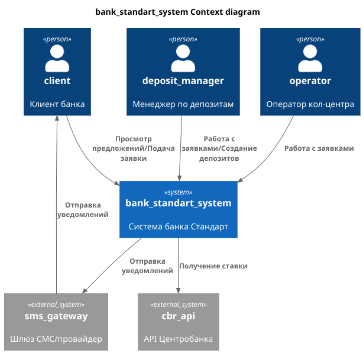
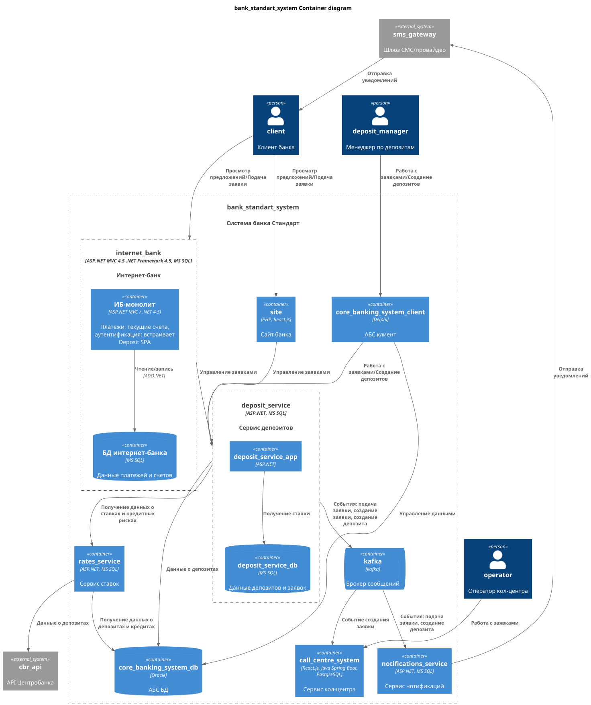
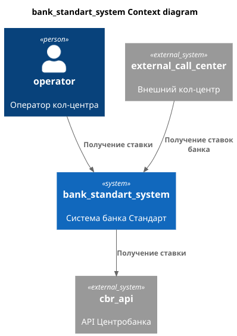
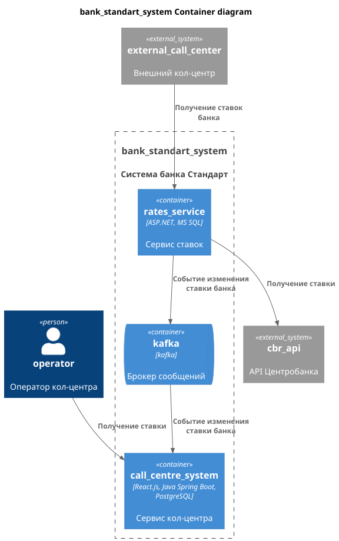
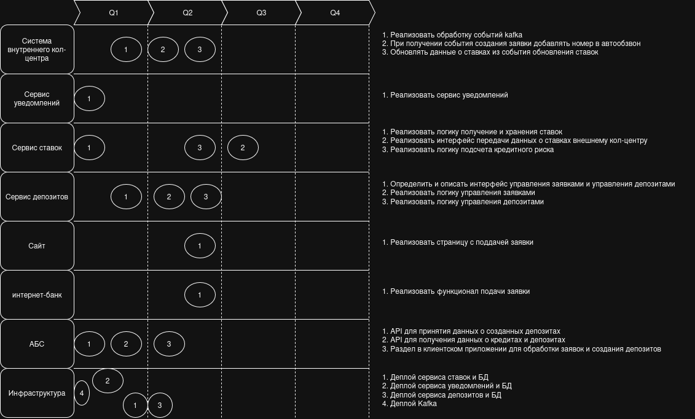

## Задание 1

### Карта ландшафта

### Схема интеграции приложений

## Задание 2

Файл с таблицей [FURPS+](Task2/FURPS+.md)

| Код | Требования                                                                                                     | Комментарий                 |
|-----|----------------------------------------------------------------------------------------------------------------|-----------------------------|
| F   | Функциональные (Functionality)                                                                                 |                             |
| F1  | Отображение доступных депозитов с актуальными ставками                                                         |                             |
| F2  | Прием заявок клиентов с персональными данными                                                                  |                             |
| F3  | Механизмы рассылки SMS уведомлений и подтверждения действий с помощью кода из SMS                              |                             |
| F4  | Ежедневный автоматический расчет и хранение итоговых ставок по депозитам                                       |                             |
| F5  | Автоматизированный расчет кредитного риска для банка                                                           |                             |
| F6  | Расчет и отображение персональных ставок по депозитом для клиента                                              |                             |
| U   | Удобство использования (Usability)                                                                             |                             |
| U1  | Простой и интуитивно понятный интерфейс пользователя                                                           |                             |
| U2  | Отклик по всем операциям должен быть максимально быстрым и занимать миллисекунды                               |                             |
| U3  | Использование системы дизайна для приложений, принятой в компании: привычные цвета и брендированные элементы   |                             |
| R   | Надёжность (Reliability)                                                                                       |                             |
| R1  | Все сервисы должны работать 24/7                                                                               |                             |
| R2  | Высокая доступность (SLA 99.9%)                                                                                |                             |
| P   | Производительность (Performance)                                                                               |                             |
| P1  | Быстрый отклик интерфейса (< 1 секунды на справочные данные)                                                   |                             |
| P2  | Горизонтальное масштабирование и распределение запросов между серверами, приложениями и ЦОД для интернет-банка |                             |
| S   | Поддерживаемость (Supportability)                                                                              |                             |
| S1  | Документация для новых API и процессов                                                                         |                             |
| S2  | Внедрение kafka  для нового процесса                                                                           |                             |
| +R  | + Ограничения (Restrictions)                                                                                   |                             |
| +R1 | Соблюдение правил обработки и передачи персональных данных                                                     | Требование законодательства |
| +R2 | Обеспечение шифрования сетевых запросов. Использование HTTPS                                                   |                             |
| +R3 | Максимальное использование технологий текущего стэка.                                                          |                             |

## Задание 3

[ADR](Task3/ADR.md)

### **Название задачи:** Концептуальная архитектура открытия депозитов для MVP
### **Автор:** Леонтьев Виталий
### **Дата:** 29.09.2026
### **Функциональные требования**
| **№** | **Действующие лица или системы**   | **Use Case**                              | **Описание**                                                                                  |
|:-----:|:-----------------------------------|:------------------------------------------|:----------------------------------------------------------------------------------------------|
|   1   | Клиент банка                       | Просмотр депозитов с актуальными ставками | Клиент в интернет-банке видит витрину депозитов с актуальными и персонализированными ставками |
|   2   | Система банка, система центробанка | Обновить ставку                           | Получение ставки рефинансирования центробанка                                                 |
|   3   | Оператор кол-центра                | Просмотр заявки на депозит                | Оператор получает данные заявки клиента при звонке                                            |
|   4   | Менеджер депозитов                 | Обработка заявок                          | Обработка заявок на депозиты, создание депозитов                                              |
|   5   | Система банка, клиент банка        | Отправка уведомлений                      | Клиент получает уведомления от банка                                                          |

### **Нефункциональные требования**
| **№** | **Требование**                                                                                                 |
|:-----:|:---------------------------------------------------------------------------------------------------------------|
|   1   | Все сервисы должны работать 24/7                                                                               |
|   2   | Высокая доступность (SLA 99.9%)                                                                                |
|   3   | Быстрый отклик интерфейса (< 1 секунды на справочные данные)                                                   |
|   4   | Горизонтальное масштабирование и распределение запросов между серверами, приложениями и ЦОД для интернет-банка |
|   5   | Внедрение kafka  для нового процесса                                                                           |
|   6   | Соблюдение правил обработки и передачи персональных данных                                                     |
|   7   | Обеспечение шифрования сетевых запросов. Использование HTTPS                                                   |
|   8   | Максимальное использование технологий текущего стэка.                                                          |

### **Решение**
За основной технологический стэк нужно принять ASP.NET и реализовывать новые сервисы на этой платформе. Команда имеет опыт работы с .NET\
Рекомендуемая СУБД для новых сервисов - MS SQL\
Внедрение Event-Driven архитектуры для нового функционала. Это позволит уменьшить связность сервисов\
Для начала цифровой трансформации требуется завершить этап цифровизации.
Текущий процесс открытия депозитов включает участие менеджера по кредитам.
Подсчет ставок и кредитных рисков возможен без участия менеджера, в первую очередь требуется автоматизировать этот процесс.
Для автоматизации подсчета ставок и кредитных рисков будет разработан отдельный сервис.\
Для уведомлений должен быть разработан новый сервис, который будет на основании событий в системе отправлять уведомления пользователям.\
Отдельный сервис для управления депозитами и заявками на открытие депозитов. Это позволит снизить нагрузку на АБС.

Диаграма контекста: [код](Task3/c4_context.puml), [картинка](Task3/c4_context.png)

Диаграма контейнеров: [код](Task3/c4_container.puml), [картинка](Task3/c4_container.png)

### **Альтернативы**
1. Отправка уведомлений через интернет-банк.
2. Реализация процесса открытия депозита в АБС.
3. Реализация процесса открытия депозита в интернет-банке.
4. Синхронное взаимодействие без kafka.

**Недостатки, ограничения, риски**
1. Большой объем изменений
2. Усложнение общей архитектуры
3. Увеличение затрат на инфраструктуру и ее поддержку
4. Внедрение микросервисной и Event-Driven архитектуры

## Задание 4

[ADR](Task4/ADR.md)

### **Название задачи:** Изменения архитектуры для кол-центров
### **Автор:** Леонтьев Виталий
### **Дата:** 29.09.2026
### **Функциональные требования**

| **№** | **Действующие лица или системы** | **Use Case**           | **Описание**                                                    |
|:-----:|:---------------------------------|:-----------------------|:----------------------------------------------------------------|
|   1   | Оператор кол-центра              | Получение ставок банка | Оператор кол-центра должен иметь доступ к ставкам банка         |
|   2   | Система внешнего кол-центра      | Получение ставок банка | Система внешнего кол-центра должен иметь доступ к ставкам банка |

### **Нефункциональные требования**
| **№** | **Требование**                                                      |
|:-----:|:--------------------------------------------------------------------|
|   1   | Нет возможности сделать API-вызовы, реализовать через SFTP-протокол |

### **Решение**
1. Для предоставления данных оператору внутреннего кол-центра банка будет реализовано событие, отправляемое при изменении ставок. В системе кол-центра нужно будет обрабатывать эти данные.
2. Требуется реализовать в системе ставок интерфейс с для того чтобы внешняя система кол-центра могла получать в нужном формате данные.
Диаграма контекста: [код](Task4/c4_context.puml), [картинка](Task4/c4_contex.png)

Диаграма контейнеров: [код](Task4/c4_container.puml), [картинка](Task4/c4_container.png)

### **Альтернативы**
1. Передача в систему внутреннего КЦ данных напрямую
2. Прямой запрос из системы внутреннего КЦ данных о ставках из сервиса

**Недостатки, ограничения, риски**
1. Специфичный способ передачи данных для партнера
2. Если нужно будет реализовывать функционал для персональных ставок, нельзя будет расширить текущее решение

### Список задач
[файл](Task4/tasks_list.md)
#### Система внутреннего кол-центра
1. Реализовать обработку событий kafka
2. При получении события создания заявки добавлять номер в автообзвон
3. Обновлять данные о ставках из события обновления ставок

#### Сервис уведомлений
1. Реализовать сервис уведомлений

#### Сервис ставок
1. Реализовать логику получение и хранения ставок
2. Реализовать интерфейс передачи данных о ставках внешнему кол-центру
3. Реализовать логику подсчета кредитного риска

#### Сервис депозитов
1. Определить и описать интерфейс управления заявками и управления депозитами
2. Реализовать логику управления заявками
3. Реализовать логику управления депозитами

#### Сайт
1. Реализовать страницу с поддачей заявки

#### интернет-банк
1. Реализовать функционал подачи заявки

#### АБС
1. API для принятия данных о созданных депозитах
2. API для получения данных о кредитах и депозитах
3. Раздел в клиентском приложении для обработки заявок и создания депозитов

#### Инфраструктура
1. Деплой сервиса ставок и БД
2. Деплой сервиса уведомлений и БД
3. Деплой сервиса депозитов и БД
4. Деплой Kafka

[roadmap](Task4/roadmap.png)

