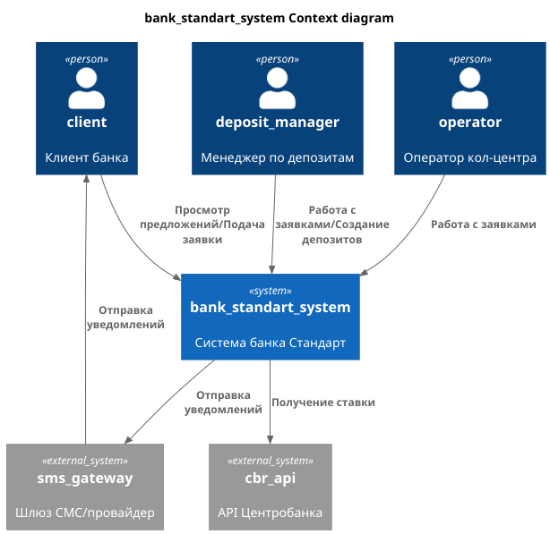
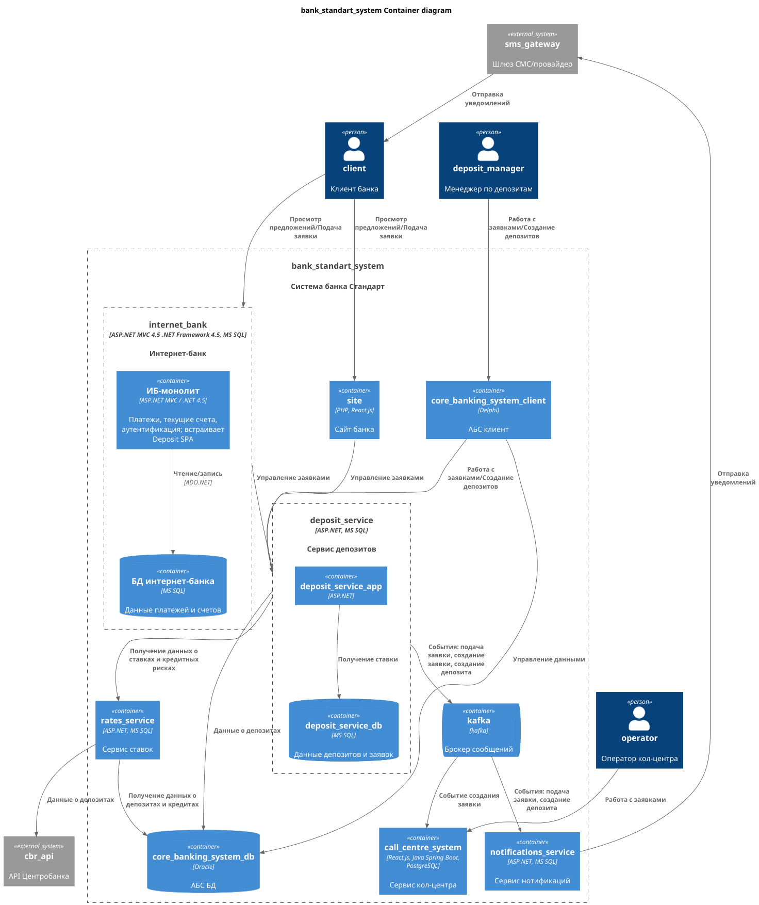

### **Название задачи:** Концептуальная архитектура открытия депозитов для MVP
### **Автор:** Леонтьев Виталий
### **Дата:** 29.09.2026
### **Функциональные требования**
| **№** | **Действующие лица или системы**   | **Use Case**                              | **Описание**                                                                                  |
|:-----:|:-----------------------------------|:------------------------------------------|:----------------------------------------------------------------------------------------------|
|   1   | Клиент банка                       | Просмотр депозитов с актуальными ставками | Клиент в интернет-банке видит витрину депозитов с актуальными и персонализированными ставками |
|   2   | Система банка, система центробанка | Обновить ставку                           | Получение ставки рефинансирования центробанка                                                 |
|   3   | Оператор кол-центра                | Просмотр заявки на депозит                | Оператор получает данные заявки клиента при звонке                                            |
|   4   | Менеджер депозитов                 | Обработка заявок                          | Обработка заявок на депозиты, создание депозитов                                              |
|   5   | Система банка, клиент банка        | Отправка уведомлений                      | Клиент получает уведомления от банка                                                          |

### **Нефункциональные требования**
| **№** | **Требование**                                                                                                 |
|:-----:|:---------------------------------------------------------------------------------------------------------------|
|   1   | Все сервисы должны работать 24/7                                                                               |
|   2   | Высокая доступность (SLA 99.9%)                                                                                |
|   3   | Быстрый отклик интерфейса (< 1 секунды на справочные данные)                                                   |
|   4   | Горизонтальное масштабирование и распределение запросов между серверами, приложениями и ЦОД для интернет-банка |
|   5   | Внедрение kafka  для нового процесса                                                                           |
|   6   | Соблюдение правил обработки и передачи персональных данных                                                     |
|   7   | Обеспечение шифрования сетевых запросов. Использование HTTPS                                                   |
|   8   | Максимальное использование технологий текущего стэка.                                                          |

### **Решение**
За основной технологический стэк нужно принять ASP.NET и реализовывать новые сервисы на этой платформе. Команда имеет опыт работы с .NET\
Рекомендуемая СУБД для новых сервисов - MS SQL\
Внедрение Event-Driven архитектуры для нового функционала. Это позволит уменьшить связность сервисов\
Для начала цифровой трансформации требуется завершить этап цифровизации.
Текущий процесс открытия депозитов включает участие менеджера по кредитам.
Подсчет ставок и кредитных рисков возможен без участия менеджера, в первую очередь требуется автоматизировать этот процесс.
Для автоматизации подсчета ставок и кредитных рисков будет разработан отдельный сервис.\
Для уведомлений должен быть разработан новый сервис, который будет на основании событий в системе отправлять уведомления пользователям.\
Отдельный сервис для управления депозитами и заявками на открытие депозитов. Это позволит снизить нагрузку на АБС.

Диаграма контекста: [код](c4_context.puml), [картинка](c4_context.png)

Диаграма контейнеров: [код](c4_container.puml), [картинка](c4_container.png)

### **Альтернативы**
1. Отправка уведомлений через интернет-банк.
2. Реализация процесса открытия депозита в АБС.
3. Реализация процесса открытия депозита в интернет-банке.
4. Синхронное взаимодействие без kafka.

**Недостатки, ограничения, риски**
1. Большой объем изменений
2. Усложнение общей архитектуры
3. Увеличение затрат на инфраструктуру и ее поддержку
4. Внедрение микросервисной и Event-Driven архитектуры
