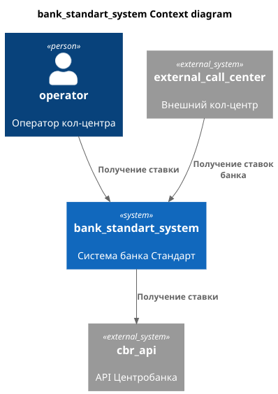
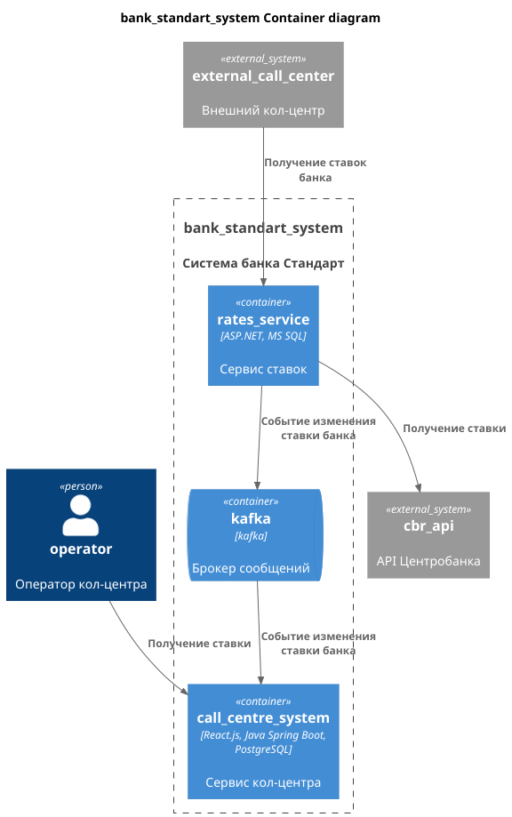

### **Название задачи:** Изменения архитектуры для кол-центров
### **Автор:** Леонтьев Виталий
### **Дата:** 29.09.2026
### **Функциональные требования**

| **№** | **Действующие лица или системы** | **Use Case**           | **Описание**                                                    |
|:-----:|:---------------------------------|:-----------------------|:----------------------------------------------------------------|
|   1   | Оператор кол-центра              | Получение ставок банка | Оператор кол-центра должен иметь доступ к ставкам банка         |
|   2   | Система внешнего кол-центра      | Получение ставок банка | Система внешнего кол-центра должен иметь доступ к ставкам банка |

### **Нефункциональные требования**
| **№** | **Требование**                                                      |
|:-----:|:--------------------------------------------------------------------|
|   1   | Нет возможности сделать API-вызовы, реализовать через SFTP-протокол |

### **Решение**
1. Для предоставления данных оператору внутреннего кол-центра банка будет реализовано событие, отправляемое при изменении ставок. В системе кол-центра нужно будет обрабатывать эти данные.
2. Требуется реализовать в системе ставок интерфейс с для того чтобы внешняя система кол-центра могла получать в нужном формате данные.
Диаграма контекста: [код](c4_context.puml), [картинка](c4_contex.png)

Диаграма контейнеров: [код](c4_container.puml), [картинка](c4_container.png)

### **Альтернативы**
1. Передача в систему внутреннего КЦ данных напрямую
2. Прямой запрос из системы внутреннего КЦ данных о ставках из сервиса

**Недостатки, ограничения, риски**
1. Специфичный способ передачи данных для партнера
2. Если нужно будет реализовывать функционал для персональных ставок, нельзя будет расширить текущее решение
